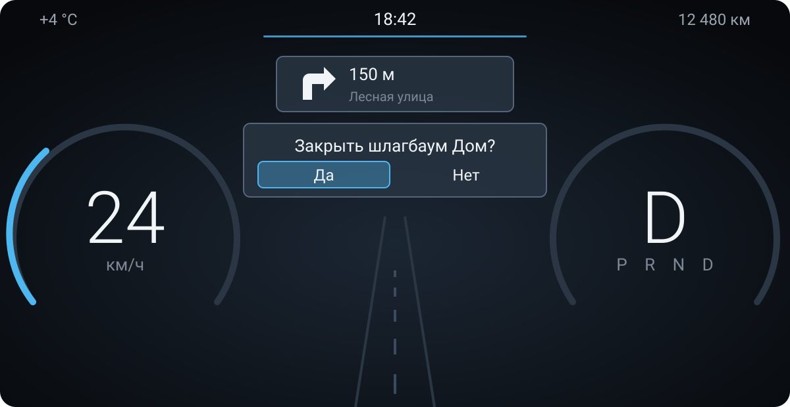
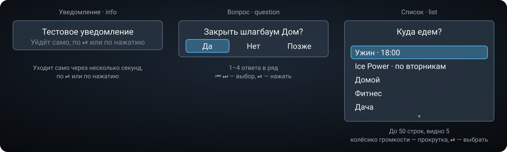

# Car Notification Service

Android-приложение для головного устройства Geely Monjaro (KX11, Android 9): единая точка показа
всплывашек на приборке. Другие приложения (первое — [barrier-opener](https://github.com/smart-car-software/barrier-opener))
не рисуют ничего сами, а отправляют запрос сюда; сервис показывает всплывашки **по очереди** и
возвращает выбранный ответ.

Три типа:

- **Уведомление** (`info`) — заголовок и текст; уходит само через несколько секунд, по ⏯ или по нажатию.
- **Вопрос** (`question`) — 1–4 ответа в ряд; ⏮ ⏭ — выбор, ⏯ — нажать.
- **Список** (`list`) — до 50 строк, видно 5; **колёсико громкости** — прокрутка, ⏯ — выбрать.

Оформление — как у вопроса открывателя ворот: панель в стиле подсказки навигатора на приборке
(дисплей #2), выбранный ответ в голубой рамке.

Если приборки нет или руль не может ответить (лог кнопок не подключился), та же карточка
показывается и на главном экране — крупнее, на неё можно нажать.

## Как это выглядит

Вопрос от [barrier-opener](https://github.com/smart-car-software/barrier-opener) на приборке,
под подсказкой навигатора; ⏮ ⏭ двигают голубую рамку, ⏯ отвечает:



Три типа всплывашек:



<sub>Это схемы, нарисованные по коду карточки (`CardView`: размеры, цвета, рамка), а не снимки
экрана; тексты — примеры.</sub>

API для клиентов — [docs/API.md](docs/API.md).

## Установка и настройка

1. Скачать APK из [Releases](https://github.com/smart-car-software/car-notification-service/releases), установить.
2. Открыть приложение, нажать «Разрешить» — «Поверх других приложений».
3. Включить «Отвечать кнопками руля». Нужны root и включённый ADB по сети (как для MConfig+). В первый
   раз голова спросит, разрешить ли отладку, — разрешить с галочкой «всегда».
4. Кнопками «Уведомление», «Вопрос», «Список» в разделе «Проверка» можно проверить показ и очередь.

## Руль

Обычным приложениям Android кнопки руля Monjaro не отдаёт. Библиотека ECarX пишет каждое нажатие
правых кнопок и колёсика громкости в системный лог (`InputImpl`, коды: ⏮ 200088, ⏭ 200087, ⏯ 200085,
громкость + 200024, − 200025). Приложение читает этот лог с root через локальный ADB-демон
(`127.0.0.1:5555`). Чтобы ⏮ ⏭ ⏯ не переключали музыку, пока висит всплывашка, сервис держит свою
медиасессию с тихим треком.

**Колёсико громкости.** Пока на экране список, шаг колёсика забирает медиасессия сервиса: им
листается список, по строке за щелчок. Громкость голова всё равно меняет сама, поэтому
переключатель «Возвращать громкость при прокрутке списка» сразу ставит её обратно: на долю
секунды она дёргается.

**Bluetooth-музыка.** На каждое нажатие ⏮ ⏭ ⏯ голова ещё и рассылает `MEDIA_BUTTON`, и
медиацентр ECarX передаёт его на телефон, если Bluetooth был последним его источником. Это
поведение головы, со всплывашкой или без; приложение перехватить это не может.

## Сборка

```bash
./gradlew testDebugUnitTest assembleDebug
VERSION_NAME=v0.1.0 KEY_PASSWORD=... ./gradlew assembleRelease
```

Тег `v*` запускает `.github/workflows/release.yml`: тесты, сборка, GitHub Release с APK.
